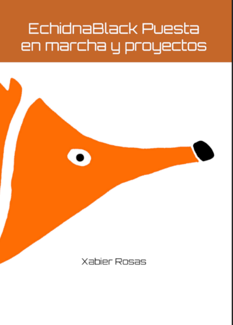

### En preimpresión
# Manuales ESO / FP  
## Galego

 
## Castellano

[Descargar el manual en castellano (PDF, 44 MB)](https://github.com/EchidnaEducacion/recursos/releases/download/manual-fp-v2/Manual_EchidnaBlack_002_Es.pdf): *EchidnaBlack. Puesta en marcha y proyectos*, de Xabier Rosas.

