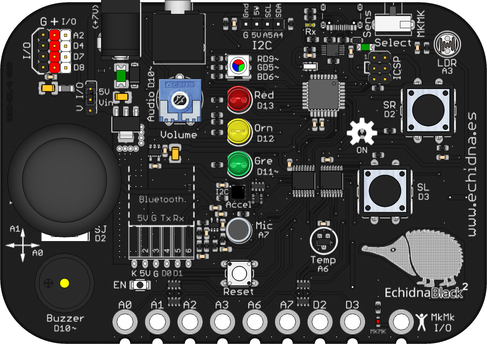

# Partes para Fritzing

> **Estos recursos se han trasladado a [Rgraficos](https://github.com/EchidnaEducacion/Rgraficos/tree/main/hardware/fritzing).**
> Allí están las versiones actualizadas, junto con instrucciones para conseguir Fritzing e
> importar las piezas. Esta carpeta se mantiene para no romper enlaces antiguos, pero ya no se
> actualiza.

## EchidnaBlack2

- [Imagen vectorial SVG](EchidnaBlack2/EchidnaBlack2.svg)
- [Archivo de Fritzing](EchidnaBlack2/EchidnaBlack2.fzpz)

## Echidna Black

- [Imagen vectorial SVG](Echidna_Black/Echidna_Black.svg)
- [Archivo de Fritzing](Echidna_Black/Echidna%20Black.fzpz)

## Echidna Shield

- [Imagen vectorial SVG](EchidnaShield/Echidna_Shield.svg)
- [Archivo de Fritzing](EchidnaShield/Echidna%20Shield.fzpz)

## Manzana

- [Imagen vectorial SVG](manzana/manzana.svg)
- [Archivo de Fritzing](manzana/Manzana.fzpz)

## Mano

- [Imagen vectorial SVG](mano/mano.svg)
- [Archivo de Fritzing](mano/mano.fzpz)

## Autoría y licencia

- Autoría: [Echidna Educación](https://echidna.es)
- Licencia: [Creative Commons Atribución-CompartirIgual 4.0 (CC BY-SA 4.0)](https://creativecommons.org/licenses/by-sa/4.0/deed.es)
